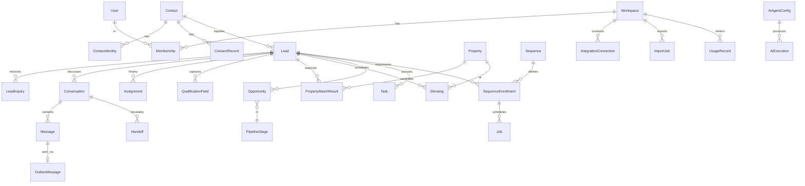
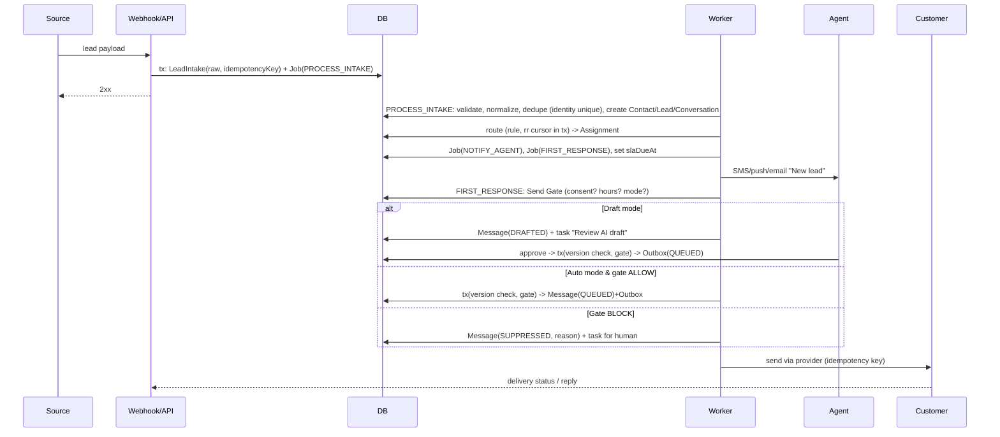
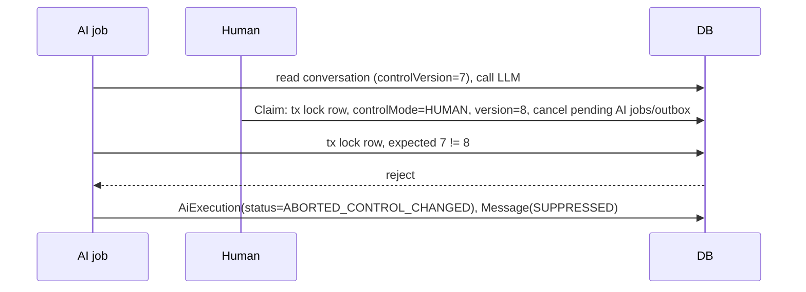

# System Architecture and Data Model

Principle: **extend the existing Next.js + Prisma + Postgres chassis**; add a worker process and a handful of tables. No microservices, no new datastore until measured need (D-09). Requirements: [PRODUCT_REQUIREMENTS](./PRODUCT_REQUIREMENTS.md). Today's schema: [CURRENT_STATE_CAPABILITY_AUDIT](./CURRENT_STATE_CAPABILITY_AUDIT.md).

## 1. Runtime topology

```mermaid
flowchart LR
  subgraph Providers
    SMS[SMS provider]-->|webhook|WH
    EML[Email inbound/outbound]-->|webhook|WH
    FORM[Web form / API / email-forward]-->|HTTPS|WH
    CAL[Calendar OAuth]
    FUB[Follow Up Boss]
  end
  WH[Next.js route handlers\n(verify signature, persist raw, ack fast)]-->DB[(Postgres)]
  UI[Next.js app (agents/managers)]-->DB
  WORKER[Worker service\npolls Job table SKIP LOCKED]-->DB
  WORKER-->|send via Send Gate + outbox|SMS
  WORKER-->EML
  WORKER-->CAL
  WORKER-->LLM[LLM provider]
  CRON[Scheduler tick (1/min)]-->DB
```

- **Web service**: UI + API + webhook receivers. Webhooks do the minimum: verify authenticity, persist raw event + `webhookEvent` claim (idempotency), enqueue jobs, return 2xx quickly. Today the whole conversation turn runs inline in the webhook request (audit §1.5); move it to a job.
- **Worker service** (same repo/image, different start command): job runner (§5), outbox dispatcher, sequence scheduler, calendar sync, health probes, retention/purge.
- **Postgres** is the system of record, queue, and lock manager (advisory locks and `FOR UPDATE SKIP LOCKED`). Reassess at sustained > ~50 jobs/s or multi-region needs.
- **Dependencies and failure behavior:** DB down → health 503, webhooks 5xx so providers retry; SMS provider down → outbox retries, UI "Not sent – retrying", owner alert after threshold; LLM down → AI falls back to "no draft"/handoff (never blocks human work); calendar down → manual workflow; email provider down → same as SMS; Redis not required.

## 2. Entity model

Existing tables kept (names unchanged): `Workspace, User, WorkspaceMember, AuthSession, AccountSetupToken, PipelineStage, Opportunity, Task, Activity, Note, Notification, AuditLog, Automation, AutomationExecution, WebhookEvent, RateLimitBucket, IntelligenceRun, CalendarEvent`. Changed: `Lead, Contact, Property, Workspace(defaults), WhatsAppMessage→Message`. New tables below. All carry `workspaceId` + indexes `(workspaceId, …)`.



### 2.1 New / changed entities (fields summarized)

| Entity | Key fields | Notes |
|---|---|---|
| **Contact** (changed) | `id, workspaceId, firstName, lastName, preferredChannel, timezone, doNotContactAll, mergedIntoId?, deletedAt` | Durable person identity. Names move here from Lead. |
| **ContactIdentity** | `id, contactId, type(PHONE\|EMAIL), valueNormalized (E.164/lowercase), label, isPrimary, verifiedAt?, ` unique `(workspaceId,type,valueNormalized)` | Enforces dedupe at DB level. Replaces Lead.phone/email/whatsappNumber duplication. |
| **Lead** (changed) | `id, contactId, workspaceId, intent(BUY\|SELL\|RENT\|UNKNOWN), stage, ownerId?, sourceId, firstReceivedAt, firstResponseAt?, firstResponseBy?(USER\|AI), qualifiedAt?, closedReason?, nextActionDueAt?, deletedAt` | One *engagement*. Soft fields (budget etc.) move to `QualificationField` rows. Keep legacy columns during migration window. |
| **LeadSource** (new, replaces enum) | `id, workspaceId, name, kind(FORM\|EMAIL\|API\|SMS\|ADS\|REFERRAL\|MANUAL\|IMPORT\|FUB), config, active` | Workspace-configurable. |
| **LeadIntake** | `id, workspaceId, sourceId, rawPayload(json), receivedAt, status(RECEIVED\|CREATED\|ATTACHED\|NEEDS_REVIEW\|FAILED), error, leadId?, idempotencyKey` | Immutable audit of every inbound lead event; unique `(sourceId, idempotencyKey)`. |
| **LeadInquiry** | `id, leadId, sourceId, receivedAt, intakeId, summary` | Repeat inquiries on an open lead keep attribution. |
| **Assignment** | `id, leadId, assigneeId?, assignedBy(USER\|RULE\|AI\|SYSTEM), ruleId?, reason, startedAt, endedAt?` | History table; `Lead.ownerId` is a cached current value. |
| **RoutingRule** | `id, workspaceId, priority, conditions(json), target(json), active, rrCursor` | Evaluated in order; `rrCursor` updated in tx. |
| **QualificationField** | `id, leadId, key, value(json), status(STATED\|IMPORTED\|INFERRED\|UNKNOWN), confidence?, sourceMessageId?, setByType, setById?, supersededAt?` | Append-only versions; latest non-superseded is current. |
| **Conversation** | `id, workspaceId, contactId, leadId, channel(SMS\|EMAIL\|WHATSAPP\|WEBCHAT), status(OPEN\|WAITING_CUSTOMER\|NEEDS_HUMAN\|RESOLVED), controlMode(AI\|HUMAN\|UNASSIGNED), controlVersion int, controllerUserId?, lastInboundAt, lastOutboundAt, slaDueAt?, aiPausedUntil?` | Replaces the `lead:<id>` string. One per contact×channel. |
| **Message** (from WhatsAppMessage) | `id, conversationId, direction, authorType(CUSTOMER\|USER\|AI\|SYSTEM), authorId?, body, status(RECEIVED\|DRAFTED\|APPROVED\|QUEUED\|SENT\|DELIVERED\|FAILED\|UNDELIVERABLE\|SUPPRESSED), provider, externalId?, errorCode?, aiExecutionId?, sentAt?, deliveredAt?` unique `(workspaceId,provider,externalId)` | Internal notes in `Note`, never here. |
| **OutboxMessage** | `id, messageId, idempotencyKey unique, provider, attempts, nextAttemptAt, status, lastError` | Written in the same tx as the control-version check; dispatcher sends. |
| **Handoff** | `id, conversationId, leadId, reason, triggeredBy(AI\|RULE\|CUSTOMER\|USER), status(OPEN\|ACKNOWLEDGED\|RESOLVED\|REASSIGNED), assigneeId, openedAt, ackAt?, resolvedAt?, contextSnapshot(json)` | Remains open until resolved; replaces `[handoff:REASON]` task-description tags. |
| **ConsentRecord** | `id, contactId, channel, purpose(TRANSACTIONAL\|SERVICE\|MARKETING\|AI_AUTOMATED), status(GRANTED\|REVOKED\|UNKNOWN), source, evidence(json: form id, ip, ua, text shown, url, timestamp), policyVersion, grantedAt, revokedAt?, scopeNote` | Append-only. Latest by `(contact,channel,purpose)` wins; REVOKED beats GRANTED unless a later explicit GRANT with evidence. |
| **Suppression** | `id, workspaceId, channel, addressNormalized, reason(STOP\|DNC\|BOUNCE\|COMPLAINT\|MANUAL), createdAt, source` unique `(workspaceId,channel,addressNormalized)` | Overrides everything. Imports cannot delete. Only an auditable explicit re-opt-in by the customer can lift (creates new ConsentRecord, closes suppression with evidence). |
| **Property** (changed) | see REQ-INV | Add `address{line1,city,state,zip,lat,lng}`, `mlsId`, `status`, `lastVerifiedAt`, `source`. |
| **PropertyMatchResult** | `id, leadId, propertyId, stage1Passed, excludedReason?, score?, reasons(json), computedAt, inputsHash` | Reproducible/explainable; cached by `inputsHash`. |
| **Showing** | `id, leadId, opportunityId?, propertyId, agentId, startAt, endAt, timezone, status, calendarConnectionId?, externalEventId?, syncStatus, rescheduledFromId?, idempotencyKey unique, outcome, feedback` | Replaces SITE_VISIT CalendarEvent for showings. |
| **Sequence / SequenceEnrollment** | definition JSON (versioned) / `leadId, status, currentStep, stoppedReason, version` | See §5. |
| **Job** | `id, type, payload, runAt, status(PENDING\|RUNNING\|DONE\|FAILED\|DEAD\|CANCELED), attempts, maxAttempts, idempotencyKey unique, lockedBy, lockedUntil, lastError, correlationId, conversationId?, enrollmentId?` | The durable queue. |
| **AiAgentConfig** | `id, workspaceId, mode(OFF\|DRAFT\|AUTO), version, policy(json), promptRef, channels, hours, killSwitch` | Every change creates a new version row; executions reference version. |
| **AiExecution** | `id, conversationId, agentConfigVersion, model, promptVersion, inputSnapshot(redacted json), toolCalls(json), output, decision, policyChecks(json), latencyMs, costUsd, status, controlVersionAtDecision, messageId?` | Replayable log; supersedes `IntelligenceRun` for conversations. |
| **IntegrationConnection** | see REQ-INT | |
| **ImportJob / ExternalRef** | `ImportJob{source, mapping, status, counts, reportRef}`; `ExternalRef{system, externalId, entityType, entityId}` unique `(workspaceId,system,externalId,entityType)` | Prevents duplicate re-imports. |
| **UsageRecord** | `workspaceId, kind(SMS_SEGMENT\|EMAIL\|AI_TOKENS\|VOICE_MIN), qty, costUsd?, periodStart, refId` | Metering; costs measured not invented. |
| **ReportEvent** (optional P1) | `leadId, type(FIRST_RESPONSE, QUALIFIED, SHOWING_BOOKED…), at, actorType` | Append-only fact table so reports don't re-derive from mutable rows. |

Unique/lock rules recap: identity unique index replaces advisory-lock-only dedupe (keep advisory lock for race on first insert); `LeadIntake` idempotency key; `Message(provider,externalId)`; `Job.idempotencyKey`; `Showing.idempotencyKey`; `ExternalRef`.

## 3. Lead / contact / opportunity lifecycle rules

- **Lead → Contact:** at intake the Contact is found by exact identity or created (never create a Contact without at least one identity). Lead always has `contactId`.
- **Repeat inquiry:** exact identity match → new `LeadInquiry` on existing *open* Lead; if the previous Lead is terminal (Won/Lost/Disqualified > 0 days) or dormant > 90 days → **new Lead**, same Contact; owner defaults to previous owner if they're active and the prior lead was Won/active in last 12 months (rule configurable).
- **Possible duplicates** (name+ZIP, shared phone across contacts) → `DuplicateCandidate` queue; no automatic merge.
- **Opportunity creation:** manual or rule-based when Lead reaches `QUALIFIED` with a side and either a showing is booked or an agent promotes it. At most one *open* opportunity per (lead, side). Opportunity links to Property optionally.
- **Ownership:** exactly one `ownerId` on Lead (agent) and one `controllerUserId/AI` on each Conversation. Opportunity owner defaults to Lead owner; reassigning a Lead prompts to move open tasks/conversations; all moves audited.

### State machines

**Lead.stage** `NEW → CONTACTED → QUALIFIED → (NURTURE ⇄ ACTIVE) → CONVERTED | LOST | DISQUALIFIED | ARCHIVED`. Allowed: NEW→CONTACTED (requires verified outbound SENT or logged call), CONTACTED→QUALIFIED (required fields satisfied by STATED/IMPORTED/confirmed), any→NURTURE, any open→LOST/DISQUALIFIED (reason required), QUALIFIED→CONVERTED (via Won opportunity; system-only), terminal→reopen (manager; audited). Invalid: NEW→CONVERTED, anything→CONTACTED by draft only, CONVERTED→NEW.

**Conversation.status** `OPEN ⇄ WAITING_CUSTOMER`, `OPEN → NEEDS_HUMAN → OPEN (after ack/resolve handoff)`, any → `RESOLVED` (outcome required) → `OPEN` on inbound. `controlMode`: `UNASSIGNED→AI|HUMAN`, `AI→HUMAN` (claim/handoff; bumps version), `HUMAN→AI` (return; policy-gated; bumps version).

**Message.status:** forward-only partial order `DRAFTED→APPROVED→QUEUED→SENT→DELIVERED`; failures `QUEUED|SENT→FAILED`, `SENT→UNDELIVERABLE`, `QUEUED→SUPPRESSED`. Late `SENT` can't overwrite `DELIVERED` (pattern exists).

**Handoff:** `OPEN→ACKNOWLEDGED→RESOLVED`, `OPEN|ACKNOWLEDGED→REASSIGNED→(OPEN for new assignee)`. New inbound messages never change status.

**Showing:** `PROPOSED→CONFIRMED→COMPLETED|NO_SHOW|CANCELED`; `CONFIRMED→RESCHEDULED(→new PROPOSED/CONFIRMED)`. COMPLETED only after `startAt`.

**Opportunity.stage:** per pipeline config; guard table in REQ-PIPE. Won/Lost/Disqualified/Deferred are terminal; reopen manager-only.

**Task:** `SUGGESTED→OPEN→DONE|SKIPPED|CANCELED`; `OPEN→OVERDUE` is derived, not stored.

**IntegrationConnection:** `NOT_CONNECTED→CONNECTING→CONNECTED⇄ACTION_REQUIRED/ERROR→DISCONNECTED`.

**Job:** `PENDING→RUNNING→DONE|PENDING(retry)|DEAD|CANCELED`.

Audit: every transition writes `AuditLog` (actor type/id, from→to, correlationId). Today's `AuditAction` enum should become a string column with a registered-event list to avoid a migration per event.

## 4. Source-of-truth policy

| Data | Authority | External copy treatment |
|---|---|---|
| Identity, consent, suppression | Synas DB | Provider opt-out lists (carrier STOP) are *also* honored: inbound STOP → mirror locally. Never rely solely on provider. |
| Message content & timeline | Synas DB (inbound persisted before ack) | Provider status = authority for **delivery state only**. |
| Delivery state | Provider webhook | Local row mirrors; unknown/missing receipt stays `SENT`, never upgraded to DELIVERED by assumption. |
| Calendar event existence | Provider (after id returned) | Local Showing holds intent; `syncStatus` reflects provider. External edits detected by sync job → flag `OUT_OF_SYNC`, no auto-overwrite. |
| Listing facts | Feed (when connected) else manual; always carries `source`+`lastVerifiedAt` | Conflicts: feed wins for fields marked feed-managed; manual overrides require reason, expire at next feed sync unless pinned. |
| Pipeline/opportunity | Synas DB | FUB companion: direction rules in INTEGRATION spec (D-06). |
| Lead ownership | Synas DB | In companion mode FUB owner mirrored read-only unless two-way enabled. |
| AI conclusions | Never authoritative | Always derived/proposed; humans/customer statements win. |

## 5. Durable execution design

1. **Producer** (webhook, UI action, scheduler) inserts `Job` with deterministic `idempotencyKey` (unique) in the same transaction as the domain change (transactional outbox) → at-most-one job per logical effect.
2. **Worker loop:** `SELECT … WHERE status='PENDING' AND runAt<=now() ORDER BY runAt FOR UPDATE SKIP LOCKED LIMIT n`; set `RUNNING`, `lockedUntil=now()+lease`; heartbeat extends; a reaper returns expired leases to `PENDING` (attempts+1).
3. **Handler contract:** re-load current state, re-evaluate stop conditions, run Send Gate, act, record result. Handlers are idempotent; external calls pass provider idempotency keys where supported (else store request id and check before retry).
4. **Failure:** exponential backoff with jitter; at `maxAttempts` → `DEAD`; "Failed automations" UI + owner notification; manual retry creates attempt generation +1.
5. **Observability:** structured log per job with `correlationId`; counters (queued, running, dead, oldest-pending-age) exposed on admin health and as alert thresholds (oldest pending > 2 min during business hours).
6. **Scheduling:** a 1-minute tick enqueues due sequence steps/SLA checks/reminders (deterministic keys make double ticks harmless).

## 6. Critical sequences

### 6.1 Inbound lead → first response



### 6.2 Human takes over while AI is mid-reply



### 6.3 Opt-out

Inbound "STOP" → webhook persists message → job `PROCESS_OPT_OUT` (priority) → tx: `Suppression` upsert, `ConsentRecord(REVOKED, source=INBOUND_STOP, evidence=messageId)`, cancel all PENDING jobs/outbox for that address, set conversation `aiPausedUntil`, audit → single confirmation message permitted by rule (transactional exemption per counsel guidance; configurable) → notify owner.

### 6.4 Showing booking

`PROPOSE_SHOWING` (agent/AI-with-approval) → slots computed from availability → message with options → customer reply parsed → `CONFIRM_SHOWING` with idempotency key `(lead, property, startAt)` → `CREATE_CALENDAR_EVENT` job → on provider id: `syncStatus=SYNCED`, else retry then `SYNC_FAILED` + task "add manually". Opportunity moves to Showing Scheduled only on CONFIRMED.

## 7. Tenancy and security architecture

- Row-level workspace scoping in the data-access layer (existing `tenant.ts`); add Postgres **RLS as defense in depth** on new tables (P1) — D-10.
- Webhook endpoints are per-provider and per-workspace resolvable (`IntegrationConnection.accountRef`); unknown account → 403 + security log (pattern exists).
- Secrets: envelope-encrypted columns; key from platform secret manager; rotation procedure in ops runbook.
- PII logging: structured logs must never include message bodies, phone numbers, or emails (hash or last-4); AI `inputSnapshot` stored redacted with retention.
- DB roles: app role (no DDL, no UPDATE/DELETE on `AuditLog` except retention job role), migration role separate (INFRA-5).
- Rate limits per IP/workspace/API key (existing bucket table).

## 8. Architectural decisions (see Decision Register for status)

A1 Postgres-backed queue over Redis/SQS. A2 Contact/Lead/Opportunity split. A3 Conversation as first-class entity with control version. A4 Send Gate + outbox as the only outbound path. A5 Append-only consent and qualification versions. A6 AI executions stored replayably; prompts versioned in repo. A7 No multi-region/real-time websockets in P0–P1 (SSE or 5 s polling for inbox; Today uses 12 s polling for notifications).
