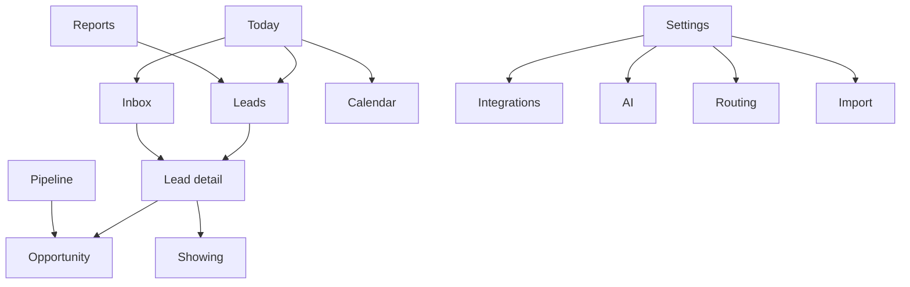

# UX and Information Architecture

Principles from the brief apply (clarity, density without clutter, accessibility, no drag-only actions, no color-only state). This doc fixes navigation and screen specs. Behavior lives in [PRODUCT_REQUIREMENTS](./PRODUCT_REQUIREMENTS.md). **Review existing UI before replacing components**: today's UI is a 17-item sidebar (Dashboard, Golden Path, Leads, Opportunities, Pipeline, Properties, Accounts, Contacts, Tasks, Proposals, Calendar, WhatsApp, Insights, Reports, Automations, Settings, Audit), Pakistan branding in the sidebar header, a ⌘K command palette, Radix UI primitives, Tailwind v4, recharts, @dnd-kit. Keep: Radix/Tailwind component base, command palette, notification bell, route-level loading/error states. Replace: navigation structure, dashboard, WhatsApp-only inbox, brand strings.

## 1. Information architecture

**Agent navigation (5 + 1):** **Today** · **Inbox** · **Leads** · **Pipeline** · **Calendar** · (overflow: Contacts, Properties, Tasks).
**Manager adds:** **Reports** · **Team**. **Admin (Settings, owner/admin):** Setup checklist · Integrations · AI & Automations · Routing · Pipelines · Import & Data · Team & Roles · Audit & Security · Billing & Usage.
Rules: remove Golden Path (demo-only) from production nav; merge Insights + Reports; retire Accounts/Proposals from primary nav (P3 / re-scope to "Offers"); each destination appears once; global search/⌘K reaches everything; badge counts only for actionable items (Inbox needs-reply count, Today overdue count).

## 2. Global patterns

- **State chips use icon + text** (e.g., ⚠ "SLA breached", ✓ "Delivered") plus color. **Actor labels:** `AI`, teammate name, `Customer`, `System`.
- **Status vocabulary** exactly as REQ doc (no "Connected" without handshake; no "Contacted" for drafts).
- **Every list:** server-side pagination, saved views, filter chips, keyboard navigation (j/k, Enter, `e` resolve in inbox), empty/loading/error/retry.
- **Responsive:** ≥1280 three-pane inbox; 768–1279 two-pane; <768 single-pane with bottom sheets. 16 px gutters, min touch target 44 px.
- **Accessibility:** WCAG 2.1 AA; semantic landmarks; focus management for dialogs/sheets; `aria-live="polite"` for new inbound messages and delivery updates; contrast ≥ 4.5:1; reduced-motion respected; **all stage changes via menu/keyboard**; DnD announces moves.
- **Destructive actions:** undo toast (soft delete/archives) or typed confirmation (hard delete, disconnect integration, deactivate member).
- **Time:** show workspace TZ with absolute time on hover; relative ages for SLA.

## 3. Screen specifications

### 3.1 Today
Goal: decide what to do next. Primary action: **Open next item** (top-priority row). Layout: single column of prioritized sections (Needs reply · Handoffs · Follow-ups due · Appointments today · Waiting on AI/customer · Stalled), each ≤5 rows with "View all (n)" to filtered list; manager gets a top band of 4 tiles (Unassigned, SLA at risk, Overdue by agent, Integration/AI issues). Mobile: same single column, sticky "Next" button. Empty: "You're clear — next scheduled item at 2:30 pm". Error: per-section retry. A11y: sections are headings with counts announced.

### 3.2 Inbox
Goal: answer people fast with safe AI/human coordination. Primary: **Send**. Secondary: Claim/Return to AI, Assign, Note, Schedule follow-up, Resolve, Propose showing.
Layout (desktop 3 panes): **List** (filters bar, priority-sorted rows: name, channel icon, owner avatar, last message snippet, age/SLA chip, state chips) | **Thread** (header: lead, owner, control state; messages; internal notes tinted + "Internal" label; AI drafts as cards with Approve/Edit/Discard; failed messages with Retry) | **Context** (qualification fields + provenance chips, matches, tasks/appointments, consent per channel, activity). Composer: banner states *AI active · AI paused (you have control) · Draft awaiting approval · SMS blocked: contact opted out*; channel selector; template picker; character/segment counter; send disabled with reason when gated. Mobile: list → thread → context sheet. Empty: "No conversations match" + clear filters. Errors: inline per message; connection loss banner with auto-retry.

### 3.3 Leads (list)
Goal: find/own/triage. Columns (≤7): Name, Source, Owner, Stage, Next action (due), Last activity, SLA flag. Saved views: My leads, Unassigned, No next action, Stalled, New today. Bulk bar: assign, tag, archive. Row click → lead detail; row quick actions: call, text, snooze. Mobile: cards with same fields. Empty: onboarding CTA to connect a source. Error: retry. Possible-duplicate banner at top when queue non-empty.

### 3.4 Lead detail
Goal: one place to act. Header: name, owner, stage chip, SLA/next-action, consent badges, **primary action = best next action** (e.g., "Review AI draft", "Propose showing"). Tabs: Overview (qualification with provenance, requirements by intent, matches with reasons/exclusions), Conversation, Timeline (messages, calls, AI executions, stage changes, assignments, audit-light), Tasks, Showings, Opportunity, Notes. Right rail on desktop; accordion on mobile. Every AI-derived item shows "AI · INFERRED 70%" with Accept/Edit.

### 3.5 Pipeline
Goal: see and move opportunities. Views: Board, Table (same data/filters). Cards: contact, value (if set), property, owner, time-in-stage (⚠ stalled), next action. Move via drag **or** card menu "Move to…" (with guard errors shown inline: "Add a close date to mark Won"). Filters: side, owner, team, stage age. Mobile: stage selector tabs + list. Empty: explain pipeline & create-from-lead flow. Concurrent change → toast "Updated by Sam; refreshed".

### 3.6 Showing/appointment workflow
Entry from match card or lead. Steps (stepper, resumable): 1 Verify listing (shows freshness, "Mark verified") → 2 Choose slots (agent availability; timezone label) → 3 Preview message & consent state → 4 Send/Propose → status timeline (PROPOSED, CONFIRMED, calendar sync state, reminders scheduled) → post-showing outcome form. Error states: `SYNC_FAILED` card with manual instructions; slot conflict recheck before confirm.

### 3.7 AI & Automations configuration
Goal: safe control. Sections: Mode per source/channel (OFF/DRAFT/AUTO with prerequisites checklist showing which are unmet), Hours & quiet hours, Tone/length, Knowledge (FAQ docs), Handoff rules (triggers, thresholds, escalation chain), Disclosure text, **Test sandbox** (chat pane with policy trace), **Executions** (searchable log with replay/"why"), **Failed automations**, **Kill switch** (prominent, requires confirm), Sequence list (P2 builder). Versioning banner: "v12 active · evaluated ✓" / "v13 draft – not evaluated, AUTO disabled".

### 3.8 Migration wizard
Stepper: Source → Upload/Connect → Discovery report → Mapping → Validation & duplicates → Sample import (staging) → Approve → Final import → Reconciliation → Cutover checklist. Each step saves progress; downloadable error CSV; clear "cannot be migrated" list; irreversible actions confirmed; shows suppression-preservation notice.

### 3.9 Integrations health
Cards per integration with state chip, last success, last error, "Run check", diagnostics drawer (recent webhooks, error codes, rate-limit status), scopes list, Disconnect (typed confirmation, shows dependent automations that will pause). 10DLC status timeline for SMS.

### 3.10 Reports
Left filters (date, source, team, agent), main: funnel + TTFR distribution + follow-up completion + lost reasons; each element has **definition popover** and "View records". Labels Actual/Estimated/Unavailable. Export CSV (audited). Mobile: stacked cards, no horizontal scroll.

### 3.11 Setup checklist (owner)
Persistent card on Today until go-live; items show criterion, state, "Next recommended step" button; deferral requires reason; progress ring.

## 4. First-session experiences

| Role | First session |
|---|---|
| Owner | Checklist → test lead → notification test → go-live; sees "what I'll measure" explainer for TTFR baseline |
| Manager | Guided tour of Today manager band & Reports; sets SLA, routing; creates saved views |
| Agent | 3-step coach marks on Today/Inbox/Lead detail in sandbox lead; notification preferences; availability hours; "send test notification" |

## 5. Copy and terminology

US English; USD, sq ft, beds/baths, MM/DD/YYYY, 12-hour time; "showing" not "site visit"; "lead", "contact", "opportunity" consistently; no "Pakistan/Zameen/Marla/Kanal/DHA" strings (audit R7); dates in workspace TZ; avoid "AI-powered" marketing language inside the app—be literal ("AI drafted this").

## 6. UX acceptance checks

Keyboard-only completion of: claim → reply → resolve; stage change; create task. Screen-reader announces new messages and send failures. 390 px width: no horizontal scroll on Today, Inbox, Leads, Pipeline. Axe automated scan has zero serious/critical on core screens. Empty/error/loading states exist for every list (route-state test pattern exists in `tests/ui/route-states.test.ts`).
