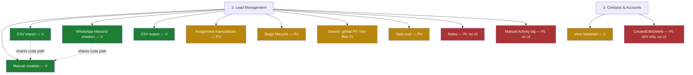
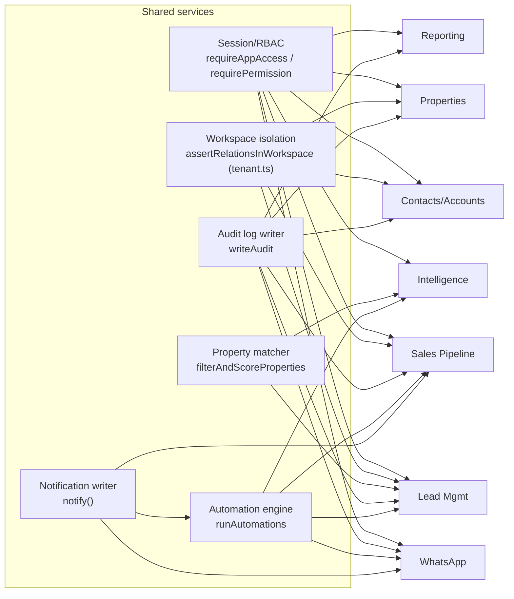

# CRM Feature Tree

Built from five full-codebase subsystem audits (routes, lib, components, Prisma schema, tests) completed 2026-10-02. Every node was checked against running code; nodes in the original brief's illustrative example that don't exist in this codebase (e.g. a standalone "deduplication" module, a configurable automation builder) are omitted or explicitly marked **Not implemented**.

## Status legend

| Code | Status | Meaning |
|---|---|---|
| 🟢 V | Implemented and verified | Code exists; tests or direct execution evidence confirm the behavior |
| 🟡 PV | Implemented, partially verified | Works; verification (tests) is incomplete |
| 🟠 PI | Partially implemented | Some steps of the workflow exist; others are missing |
| 🔵 UO | UI-only / placeholder | UI exists but no real backend operation (none found in this codebase — see note) |
| 🟣 DS | Demo / simulated | Behavior is deterministic/local simulation, not a live external call |
| 🟤 CD | Configuration-dependent | Behavior depends on env vars / provider credentials |
| 🔴 NI | Not implemented | No meaningful implementation exists |
| ⚪ UNK | Unknown / unverified | Insufficient evidence |

**Note on direction of incompleteness:** this codebase's dominant failure mode is the *opposite* of the classic "UI-only placeholder" — most gaps here are **complete, permissioned, audited backends with no UI entry point** (Contacts/Accounts CRUD, Notes, manual Activity/Task creation, intelligence review, 3 of 10 AI report types, pipeline-stage configuration, calendar event editing, member invitation). These are marked 🟠 PI with an inline note rather than forced into "UI-only / placeholder," which would describe the reverse situation.

---

## Full hierarchy

```
Lead-to-Sale CRM
│
├── 1. Workspace & Access Management                                   [docs/security/*.md — not re-audited here]
│   ├── Authentication (email+password, Auth.js v5)                    🟢 V
│   ├── Session validation & revocation (AuthSession table)            🟢 V
│   ├── Logout                                                         🟢 V
│   ├── Workspace membership — role change / removal                   🟢 V
│   ├── Workspace membership — invite / add new member                 🔴 NI  (no UI or API exists at all)
│   ├── Roles & permissions (5 fixed roles, DB-enforced)                🟢 V
│   └── Workspace branding (white-label)                                🟢 V
│
├── 2. Lead Management
│   ├── Lead creation — manual form                                    🟢 V  (no duplicate detection)
│   ├── Lead creation — CSV import                                     🟢 V  (insert transactional + deduped)
│   ├── Lead creation — WhatsApp inbound                                🟢 V  (shares the same create-lead code path)
│   ├── CSV export                                                      🟢 V  (500-row cap)
│   ├── Lead profile / detail view                                      🟢 V
│   ├── Lead assignment — manual                                        🟡 PV
│   ├── Lead assignment — least-loaded auto-assign                      🟡 PV  (no direct UI caller found)
│   ├── Stage / lifecycle management                                    🟡 PV  (two inconsistent paths to CONVERTED)
│   ├── Global command-palette search                                   🟡 PV  (untested)
│   ├── Leads-list filter/search                                        🟠 PI  (client-side only, capped at first 100 leads)
│   ├── Human hand-off take-over                                        🟡 PV
│   ├── Notes (threaded, author-attributed)                             🟠 PI  (backend complete; zero UI entry point anywhere)
│   └── Manual Activity logging                                         🟠 PI  (backend complete; no "log activity" button exists)
│
├── 3. Contacts & Accounts Directory
│   ├── View contact / account list & detail                            🟢 V
│   ├── Create / edit / delete a Contact                                 🟠 PI  (API complete; no UI entry point)
│   └── Create / edit / delete an Account                                🟠 PI  (API complete; no UI entry point)
│
├── 4. Property Inventory & Matching
│   ├── Property CRUD                                                   🟢 V
│   ├── Deterministic property-matching algorithm                       🟢 V  (shared by 7 call sites, no duplication; untested)
│   └── Property status auto-update on won deal                         🔴 NI  (winning an Opportunity never flips linked Property to SOLD)
│
├── 5. Intelligence Layer ("AI")                                         — see note below on real vs. simulated
│   ├── Lead scoring (fit/intent/value, weighted rules)                 🟢 V  (deterministic math; no tests)
│   ├── Lead analysis                                                    🟣 DS  (one seeded lead has a fully hardcoded response)
│   ├── Call preparation                                                 🟣 DS
│   ├── Site-visit preparation                                           🟣 DS
│   ├── Follow-up / Email / LinkedIn draft                               🟣 DS  (same hardcoded-lead override on WhatsApp channel)
│   ├── Property-match explanation                                       🟣 DS
│   ├── Opportunity summary                                              🟠 PI  (implemented; no UI entry point)
│   ├── Lost-deal analysis                                                🟠 PI  (implemented; no UI entry point)
│   ├── Proposal summary                                                  🟠 PI  (implemented; no UI entry point)
│   ├── Intelligence review / approval workflow                          🟠 PI  (implemented; no UI entry point for any role)
│   ├── Next-best-action                                                  🟢 V  (shown on lead page; its own API route is unused)
│   └── Insights dashboard (reports)                                      🟡 PV  (live SQL aggregates; explicitly labeled "AI not used" in its own UI copy)
│
├── 6. WhatsApp Communication
│   ├── Inbound webhook (Meta Cloud API contract, HMAC-verified)         🟢 V
│   ├── Outbound sending — Demo provider (default)                       🟣 DS
│   ├── Outbound sending — real Meta Cloud API provider                  🟤 CD  (real HTTP calls; off unless two env vars + a flag are set)
│   ├── Conversation inbox / inbox filters                                🟢 V
│   ├── Automated conversational reply engine                             🟢 V  (deterministic decision tree + optional AI-assist fallback)
│   ├── Requirement extraction from message text                          🟢 V  (regex/keyword, explicitly not an LLM)
│   └── Human hand-off detection                                          🟢 V  (regex/keyword rules, prioritized, tested against prompt injection)
│
├── 7. Automation Engine
│   ├── Seeded trigger → action rules (9 of 10 AutomationTrigger values)  🟡 PV  (actions are not idempotent; a retry can double-create a Task)
│   ├── `AUTOMATION_FAILED` trigger                                       🔴 NI  (defined in schema; never fired by any code path)
│   ├── Execution history / log viewer                                    🟢 V
│   ├── Pause / resume an automation                                      🟢 V
│   ├── Custom automation authoring (conditions/actions editor)           🔴 NI  (schema supports it; no UI or API exists)
│   ├── Inactive-lead re-engagement sweep                                  🟠 PI  (works; no UI button and no cron trigger it)
│   └── In-app notifications (bell icon)                                   🟢 V  (12-second polling, no push)
│
├── 8. Sales Pipeline
│   ├── Pipeline board (drag-and-drop stage moves)                        🟡 PV
│   ├── Pipeline stage configuration (add/rename/reorder/retire)          🔴 NI  (read-only display only; stages are fixed seed data)
│   ├── Opportunity creation / update                                     🟡 PV  (owner reassignment not gated like lead assignment)
│   ├── Won outcome → lead conversion                                     🟢 V  (idempotent, tested)
│   ├── Won outcome → property status update                              🔴 NI
│   ├── Lost outcome handling                                              🟠 PI  (status field only; no dedicated automation/trigger, no reason-capture UI)
│   ├── Proposal creation / send / status lifecycle                       🟡 PV
│   ├── Proposal view-tracking (viewCount/viewedAt)                       🟣 DS  (self-reported by an internal user, not real tracking)
│   ├── Proposal "acceptance"                                              🟣 DS  (explicitly labeled in-product as simulated, not e-signature)
│   ├── Task status updates (complete/start)                               🟢 V
│   ├── Manual task creation                                               🔴 NI  (every Task is created by automation/CSV/seed, never by a user)
│   ├── Calendar event creation (site visits)                              🟣 DS  (Demo provider; "Google" provider writes identically)
│   ├── Google Calendar sync                                               🔴 NI  (no OAuth flow, no real Google API call anywhere, despite env-var scaffolding)
│   └── Calendar event edit / complete / cancel / delete                   🔴 NI  (full API exists; zero UI entry point)
│
├── 9. Reporting & Audit
│   ├── Dashboard (KPIs, trend chart, priority actions)                   🟢 V  (live aggregates; two divergent metric code paths)
│   ├── Reports / Insights page                                           🟡 PV  (live aggregates; zero test coverage of the math)
│   └── Audit trail viewer                                                 🟢 V  (writes verified complete; read UX has no pagination/filter despite backend support)
│
└── 10. Demo, Onboarding & Ops Tooling
    ├── Demo-mode gating (`DEMO_MODE` env var)                             🟢 V  (fails closed; unit-tested)
    ├── Demo reset (two fixed demo workspaces)                             🟢 V
    ├── Golden Path guided walkthrough                                     🟣 DS / 🟤 CD  (real API calls end-to-end; inert outside Demo Mode, no warning shown)
    └── Health check endpoint                                              🟢 V  (Railway liveness probe)
```

---

## Mermaid: top-level capability map

```mermaid
flowchart TB
    ROOT["Lead-to-Sale CRM"]
    ROOT --> C1["1. Workspace & Access"]
    ROOT --> C2["2. Lead Management"]
    ROOT --> C3["3. Contacts & Accounts"]
    ROOT --> C4["4. Property & Matching"]
    ROOT --> C5["5. Intelligence Layer"]
    ROOT --> C6["6. WhatsApp"]
    ROOT --> C7["7. Automation Engine"]
    ROOT --> C8["8. Sales Pipeline"]
    ROOT --> C9["9. Reporting & Audit"]
    ROOT --> C10["10. Demo & Ops Tooling"]

    classDef verified fill:#1e7e34,color:#fff,stroke:#145523
    classDef partial fill:#b8860b,color:#fff,stroke:#8a6508
    classDef mixed fill:#555,color:#fff,stroke:#333

    class C1,C2 verified
    class C3,C4,C5,C7,C8,C9 mixed
    class C6,C10 partial
```



## Mermaid: Lead Management & Directory detail



## Mermaid: Intelligence & WhatsApp detail

```mermaid
flowchart TB
    INT["5. Intelligence Layer"]
    INT --> I1["Lead scoring — V deterministic"]
    INT --> I2["Lead analysis / call-prep / site-visit-prep / drafts — DS deterministic templates"]
    INT --> I3["Opportunity summary / lost-deal / proposal summary — PI: built, no UI"]
    INT --> I4["Review & approval workflow — PI: built, no UI"]
    INT --> I5["Next-best-action — V"]
    INT --> I6["Insights/Reports — PV, explicitly non-AI"]

    WA["6. WhatsApp"]
    WA --> W1["Inbound webhook — V, real Meta contract"]
    WA --> W2["Outbound Demo provider — DS, default"]
    WA --> W3["Outbound real Meta provider — CD, off by default"]
    WA --> W4["Conversational reply engine — V, deterministic + optional AI-assist"]
    WA --> W5["Hand-off detection & takeover — V"]
    WA --> W6["Requirement extraction — V, regex-based"]

    W4 -.only if extractor finds nothing.-> OAI["Real OpenAI call — CD, used ONLY here"]
    I2 -.never calls.-> OAI

    classDef verified fill:#1e7e34,color:#fff
    classDef partial fill:#b8860b,color:#fff
    classDef gap fill:#a33,color:#fff
    classDef demo fill:#6a4c93,color:#fff
    classDef config fill:#2a6f97,color:#fff

    class I1,I5,W1,W4,W5,W6 verified
    class I6 partial
    class I3,I4 gap
    class I2,W2 demo
    class W3,OAI config
```



## Mermaid: Automation Engine & Sales Pipeline detail

```mermaid
flowchart TB
    AE["7. Automation Engine"]
    AE --> A1["9/10 triggers wired — PV, actions not idempotent"]
    AE --> A2["AUTOMATION_FAILED trigger — NI, never fired"]
    AE --> A3["Execution log — V"]
    AE --> A4["Pause/resume — V"]
    AE --> A5["Custom rule authoring — NI"]
    AE --> A6["Inactive-lead sweep — PI, no UI/cron"]
    AE --> A7["Notifications — V, polling"]

    SP["8. Sales Pipeline"]
    SP --> S1["Pipeline board drag-drop — PV"]
    SP --> S2["Stage configuration — NI"]
    SP --> S3["Opportunity CRUD — PV, owner-reassign gap"]
    SP --> S4["Won -> Lead CONVERTED — V"]
    SP --> S5["Won -> Property status — NI"]
    SP --> S6["Proposal lifecycle — PV"]
    SP --> S7["Proposal view-tracking/acceptance — DS"]
    SP --> S8["Task status updates — V"]
    SP --> S9["Manual task creation — NI"]
    SP --> S10["Calendar create (site visit) — DS"]
    SP --> S11["Google Calendar sync — NI, no OAuth/API calls"]
    SP --> S12["Calendar edit/cancel/delete — NI, no UI"]

    A1 -->|CREATE_TASK action| S9
    S4 -->|STAGE_CHANGED trigger| A1

    classDef verified fill:#1e7e34,color:#fff
    classDef partial fill:#b8860b,color:#fff
    classDef gap fill:#a33,color:#fff
    classDef demo fill:#6a4c93,color:#fff

    class A3,A4,A7,S4,S8 verified
    class A1,S1,S3,S6 partial
    class A2,A5,A6,S2,S5,S9,S11,S12 gap
    class S7,S10 demo
```



---

## Feature dependency map

These are the shared services every feature branch above is built on. A change to any of these affects multiple branches at once.



**Reading this:** `src/lib/tenant.ts` (workspace isolation) and `requirePermission`/`requireAppAccess` (session+RBAC) are load-bearing for every single feature — this is why the security audit's findings there (F-01, F-02, F-03) mattered product-wide, not just for one screen. The **Automation Engine** is the second-most-connected node: Lead creation, every pipeline stage change, proposal send/view, and site-visit completion all flow through it, which is also why its lack of idempotency (PF-17) is a cross-cutting risk rather than a local one — any of those four trigger points can double-fire a Task if retried.
