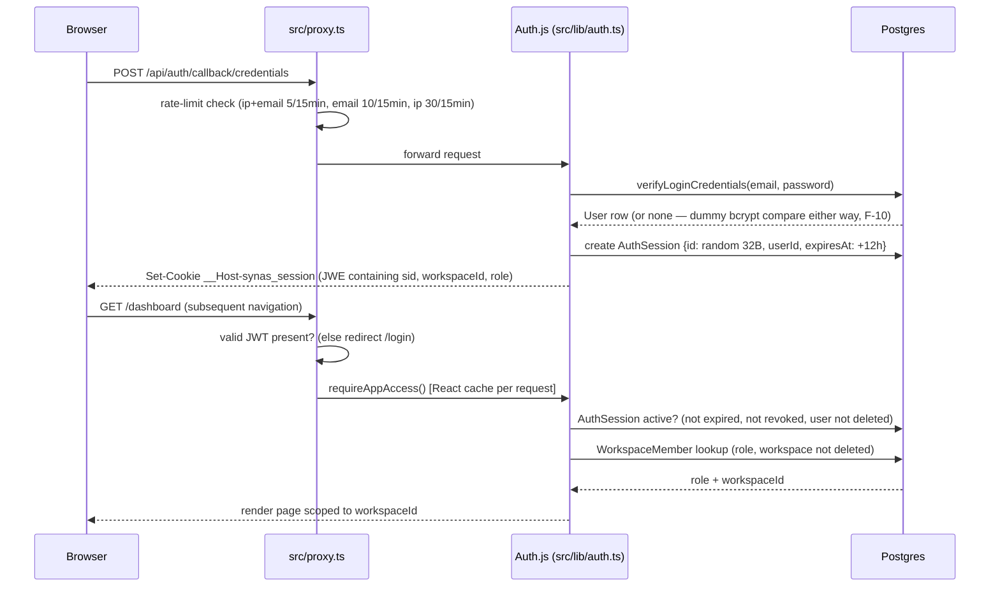
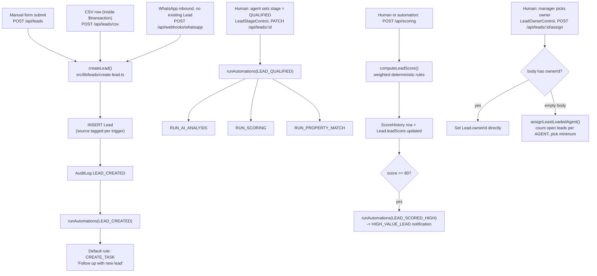
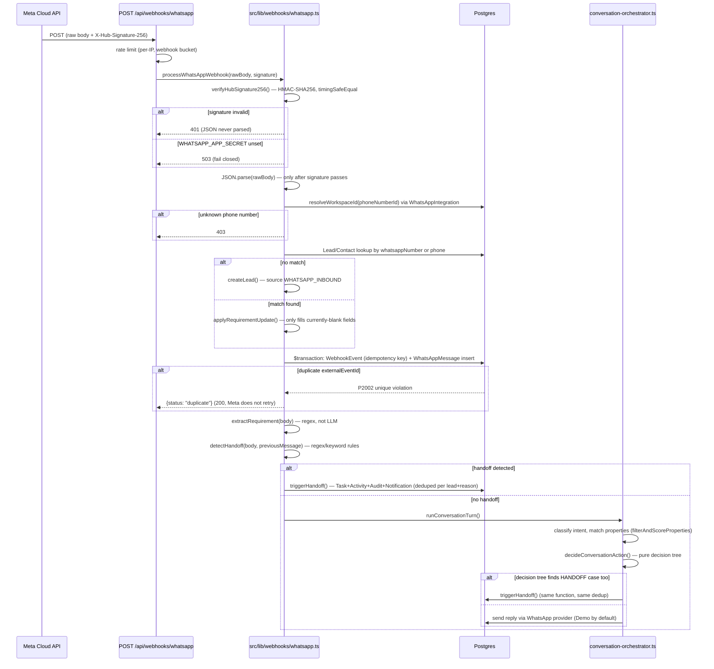
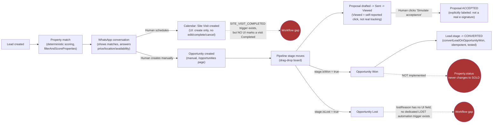
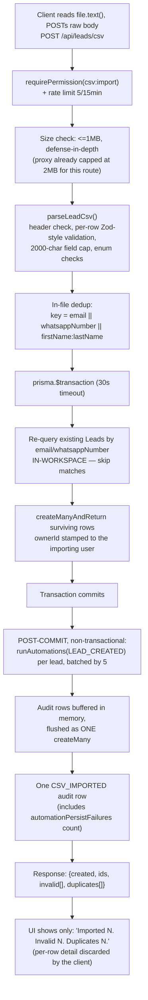
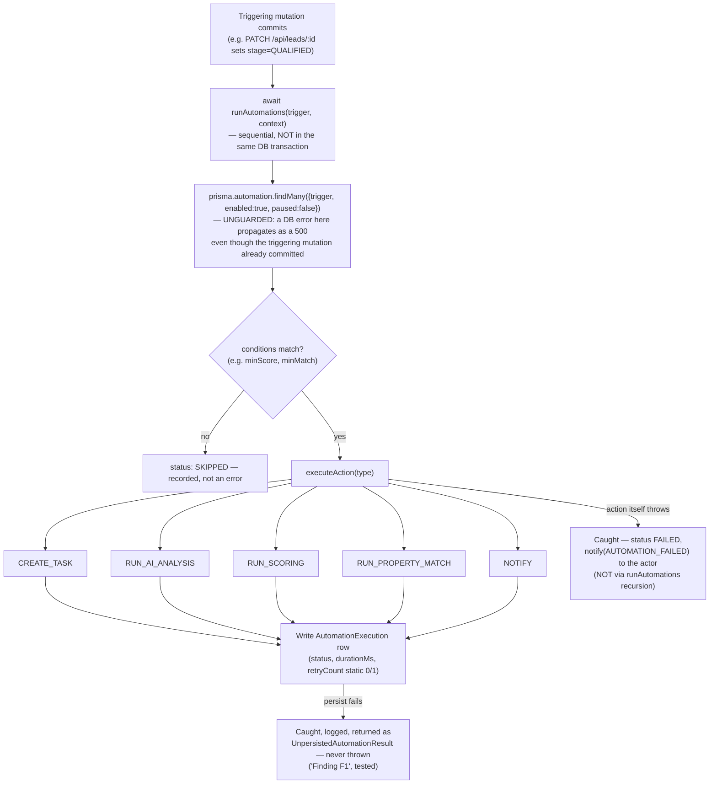

# CRM Workflow Maps

Six workflows traced end-to-end through real code (not the product's name or intended design). Each one states exactly where it stops, where a human is required, where logic is deterministic vs. simulated, and what happens on failure. Citations are `path:line` against the working tree.

---

## 1. Login → Session Validation → Workspace Authorization

**Starting event:** User submits email/password on `/login`.

**Business rules:** role is read from `WorkspaceMember` in the database on every request — never trusted from the JWT (`docs/security/DATABASE-SESSION-SECURITY-AUDIT.md` §8). Session is valid at most 8h idle / 12h absolute, whichever comes first.

**DB writes:** `AuthSession` (create on login, `revokedAt` set on logout or member removal), `AuditLog{USER_LOGIN}` / `{USER_LOGOUT}`.

**Failure/retry:** three independent rate-limit buckets (ip+email, email, ip) return 429 with `Retry-After` on brute force. An expired/revoked/missing `AuthSession` at any later request forces re-login, even with a cookie that hasn't technically expired.

**Where it stops / relies on a human:** nowhere — fully automated, no manual step.

**Verification:** this flow is the most heavily tested path in the repo — see `tests/security/session-hardening.test.ts` (24 tests), `tests/security/auth-credentials.test.ts`, plus the live HTTP attack harness recorded in `docs/security/PRODUCTION-READINESS-CHECKLIST.md` (54/54 checks against a production build). **Status: Implemented and verified.**

---

## 2. Lead Creation → Qualification → Scoring → Assignment

**Starting event:** three different triggers converge on the same code (`src/lib/leads/create-lead.ts:11-65`): a manual form submit, a CSV row, or a WhatsApp inbound message from an unknown number.

**Business rules:** qualification is **entirely manual** — there is no automatic promotion to `QUALIFIED` based on score or any other signal; `LeadStageControl` is the only UI control that can make this transition (`src/components/leads/lead-stage-control.tsx:8-13`). Scoring is a deterministic weighted formula (`fit*0.22 + intent*0.2 + value*0.18 + engagement*0.12 + bestPropertyMatch*0.1 + response*0.08 + pipeline*0.06 + siteVisit*0.04`, `src/lib/scoring/score-lead.ts:164-173`) — no machine learning, no LLM call. Assignment is either a direct manager pick or a least-loaded-agent algorithm that only counts leads in `NEW/CONTACTED/QUALIFIED/NURTURING`.

**DB writes:** `Lead` (insert, then stage/score/owner updates), `AuditLog` (`LEAD_CREATED`, `LEAD_STAGE_CHANGED`/`LEAD_UPDATED`, `SCORE_UPDATED`), `ScoreHistory`, `Task` (via automation), `Notification` (score-increase / high-value).

**External provider calls:** none — the entire path is deterministic Prisma reads/writes.

**Failure/retry:** lead insert, audit write, and automation run are three **sequential**, not transactional, statements for manual creation — a crash between them can leave a Lead with no audit row or no follow-up task. CSV import wraps the insert in a DB transaction but still runs automations afterward, non-transactionally (see Workflow 5). A repeated `LEAD_CREATED`/`LEAD_QUALIFIED` trigger (e.g. a retried request) will **create a second Task** — automation actions are not deduplicated (confirmed, `tests/security/csv-automations.test.ts:173-194`).

**Where it stops / relies on a human:** qualification (stage change) and assignment both require a human click; nothing in this codebase auto-qualifies or auto-assigns a lead on creation.

**Status: Implemented and verified** for creation, scoring, and manual assignment; **Implemented, partially verified** for automation side effects (non-idempotent, non-transactional with the triggering write).

---

## 3. WhatsApp Inbound → Signature Verification → Persistence → Extraction → Matching/Handoff

**Starting event:** Meta Cloud API POSTs a webhook event to `/api/webhooks/whatsapp`.

**Business rules:** signature verification happens **before** the body is parsed as JSON (tested explicitly). Confirmed fields are never overwritten by a later, possibly contradictory message (`isBlank()` check, `src/lib/whatsapp/extract-requirement.ts:34-36`). The conversational reply engine only asks one clarification question at a time, in a fixed priority order (`propertyPurpose → propertyTypePref → preferredArea → budget → size`), and refuses to assert a property's availability if its status looks stale — it hands off instead of guessing. An **optional** AI-assist step runs only if both the deterministic extractor and intent classifier find nothing, and only if `OPENAI_API_KEY` is set; it is locked down with a system prompt that is tested against prompt-injection ("ignore previous instructions...") and never used to write the outbound message body — that's always a deterministic template.

**DB writes:** `WebhookEvent` (idempotency), `WhatsAppMessage` (inbound + outbound), `Lead` (create or requirement-field fill), `Activity`/`Task`/`AuditLog`/`Notification` (on handoff).

**External provider calls:** inbound is always the real Meta Cloud API webhook contract (no demo substitute exists for inbound — a separate authenticated `/api/whatsapp/simulate-inbound` endpoint exists for demo purposes instead). Outbound reply delivery goes through whichever provider is configured — Demo (local DB write only, default) or the real Meta Graph API send (`https://graph.facebook.com/{version}/{phoneNumberId}/messages`, config-gated — see Workflow 6 provider note).

**Failure/retry:** idempotent on `(provider, externalEventId)` — a duplicated Meta delivery is a no-op, confirmed under test. A genuine 500 inside the handler causes Meta to retry (expected and safe, since each message's persistence is one transaction). Unsupported message types (image/video/etc.) are stored with a placeholder body and never enter extraction/handoff/conversation logic.

**Where it stops / relies on a human:** any detected handoff reason — explicit human request, negotiation, a question the deterministic engine can't safely answer, repeated/confused customer messages, or zero inventory matches for a fully-specified requirement. The engine is explicitly designed to **hand off rather than guess** in all of these cases (`conversation-intelligence.ts:175-178`, comment: "AI must not make this business decision").

**Status: Implemented and verified** — this is the most thoroughly tested workflow in the repository (`tests/security/webhook.test.ts`, `webhook-flow.test.ts`, `conversation-flow.test.ts`).

---

## 4. Lead → Property Match → Conversation → Site Visit → Opportunity → Proposal → Won/Lost

This is the "full funnel" the product's name implies. Tracing it against real code shows where it actually connects and where it breaks.

**What's real:** Lead creation, property matching, and the WhatsApp conversation are fully automated and connected. `Opportunity` creation is a **manual, independent step** — nothing in the code auto-creates an Opportunity when a conversation reaches a buying signal; an agent has to open `/opportunities` and create one by hand, optionally linking the originating Lead and matched Property. Pipeline movement, proposal status, and the win→lead-conversion step are all real, audited, and (for lead conversion) tested.

**What breaks or stops short:**
- **Site visits have no completion path in the UI.** The `SITE_VISIT_COMPLETED` automation trigger and its "log visit notes" follow-up task exist in the engine, but since there's no UI to mark a `CalendarEvent` as `COMPLETED` (only creation exists), this part of the funnel is **unreachable in practice**.
- **Winning a deal never updates the linked Property's status.** A real-estate CRM's most natural automation — "won deal ⇒ property marked sold" — does not exist. The property stays `AVAILABLE` (or whatever it was) indefinitely after the deal that sold it closes.
- **"Lost" has no dedicated handling.** `lostReason` is a schema field with no UI to populate it; `src/lib/insights.ts` and `src/lib/ai/lost-deal-analysis.ts` both fall back to a literal default string ("Marked lost without a captured reason") because nothing ever fills it in practice.
- **Proposal engagement tracking is self-reported**, not real: there is no public proposal link or tracking pixel anywhere in the codebase — an agent manually clicks "Mark viewed."

**Status: Partially implemented.** The pieces that exist are solid and tested individually; the *connective tissue* between conversation → opportunity → site-visit-completion → won → property-status is either manual (by design, requiring a human to create the Opportunity) or simply absent (property status, lost-reason capture, visit completion).

---

## 5. CSV Upload → Parsing → Validation → Deduplication → Transaction → Automation Execution

**Starting event:** agent selects a CSV file on `/leads` and clicks Import.

**Business rules:** the insert itself is fully transactional and deduplicated both within the file and against the database (workspace-scoped). The 500-row and 1MB limits are enforced both at the proxy layer and again inside the route handler. Dedup checks only `email`/`whatsappNumber` — not plain `phone` — so two rows differing only by which field is populated can still both import.

**DB writes:** `Lead` (createMany, inside the transaction), `Task`/`AutomationExecution`/`Notification` (automations, outside the transaction), `AuditLog` (one `CSV_IMPORTED` summary row).

**Failure/retry — the audit's explicit question about partial failure after commit:** **Yes, this workflow can partially fail after its DB write commits.** The lead rows are atomic (all-or-nothing, bounded by the 30s transaction timeout). Everything after that — automation execution and its own bookkeeping audit row — runs afterward, outside any transaction. The test suite names this explicitly as **"Finding F1"**: an `AutomationExecution` persistence failure never masks a real action's success and never throws, but it also means a batch can commit N leads while 0 to N of their `LEAD_CREATED` automations (and the Tasks/Notifications they create) silently fail to log, or — on a retried batch — fire a **second time**, creating duplicate Tasks (`tests/security/csv-automations.test.ts:173-194`, explicitly documented as an unfixed gap, not a hidden one).

**Where it stops / relies on a human:** the import click itself; everything downstream is automatic. The UI's decision to discard per-row error/duplicate detail means a human reviewing a large failed import has to re-derive which rows failed by comparing the file to the resulting lead list — the API returns the detail, the UI just doesn't show it.

**Status: Implemented and verified** for the insert path (transactional, tested); **Partially implemented** for the automation side effects (documented, non-transactional, non-idempotent on retry).

---

## 6. Trigger → Automation Rule Evaluation → Action Execution → Task/Notification/Audit

**Starting event:** any of the 9 live `AutomationTrigger` call sites fires — `LEAD_CREATED`, `LEAD_QUALIFIED`, `LEAD_SCORED_HIGH`, `STRONG_PROPERTY_MATCH`, `STAGE_CHANGED`, `PROPOSAL_SENT`, `SITE_VISIT_COMPLETED` (currently unreachable — see Workflow 4), `LEAD_INACTIVE` (reachable only via a direct API call, no UI/cron), `PROPOSAL_VIEWED`. The 10th enum value, `AUTOMATION_FAILED`, is never fired by any code path.

**Business rules:** every action type is a plain, synchronous function call — no queue, no background worker, no retry/backoff mechanism (`AutomationExecution.retryCount` is a static 0-or-1 flag, never an actual counter). **None of the five action types are idempotent.** `CREATE_TASK` is confirmed to double-create a Task if the same trigger fires twice for the same lead (e.g. a retried request) — this is demonstrated and explicitly left unfixed in the test suite, not an oversight discovered by this audit. The only idempotency anywhere adjacent to automations is the **handoff** task-tag dedup (a separate code path, keyed per lead+reason) and the webhook's `WebhookEvent` unique-constraint dedup — neither protects the automation engine itself.

**DB writes:** `AutomationExecution` (one row per action attempt), `Task`/`IntelligenceRun`/`ScoreHistory`/`Notification` depending on the action, `AuditLog` (batched for CSV-triggered runs, per-row otherwise).

**Failure/retry:** the engine is internally defensive — almost every failure mode (condition-check errors, action errors, bookkeeping-write errors) is caught and recorded as a `FAILED`/unpersisted result rather than thrown, so a flaky automation action cannot turn a successful user-facing mutation into an HTTP error. The one exception: the initial `prisma.automation.findMany` lookup is **not** wrapped in try/catch — a database hiccup exactly there would surface as a 500 to the user even though their actual action (e.g. sending a proposal) already succeeded and committed.

**Where it stops / relies on a human:** nothing in this workflow requires a human — it's the one fully autonomous chain in the product. The human dependency is upstream of it (someone has to trigger `LEAD_QUALIFIED`, `STAGE_CHANGED`, etc. by using the product) and downstream of it (someone has to act on the Task/Notification it creates).

**Status: Implemented, partially verified.** The execute/persist/audit path itself is well-tested (`tests/security/csv-automations.test.ts`); the non-idempotency and the dead `AUTOMATION_FAILED` trigger are confirmed, named gaps rather than untested uncertainty.
